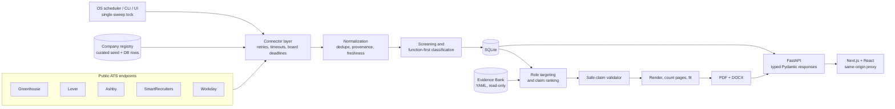
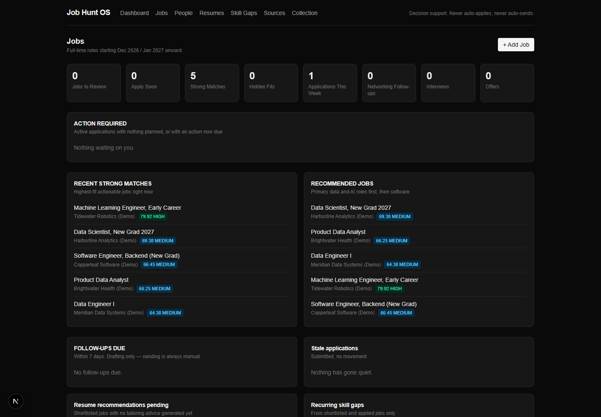
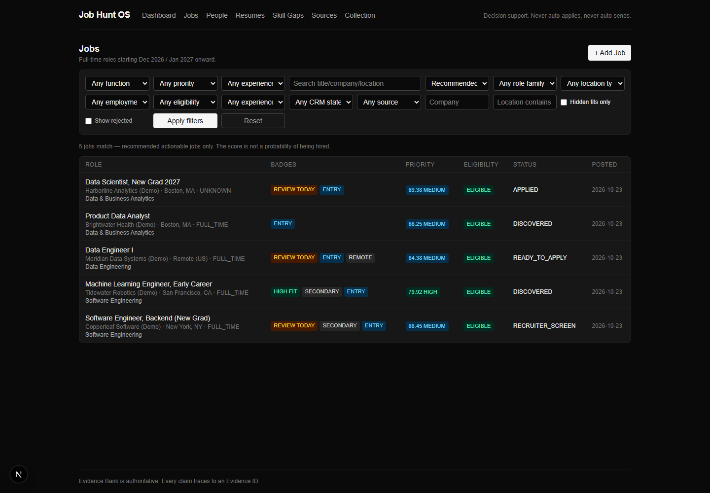
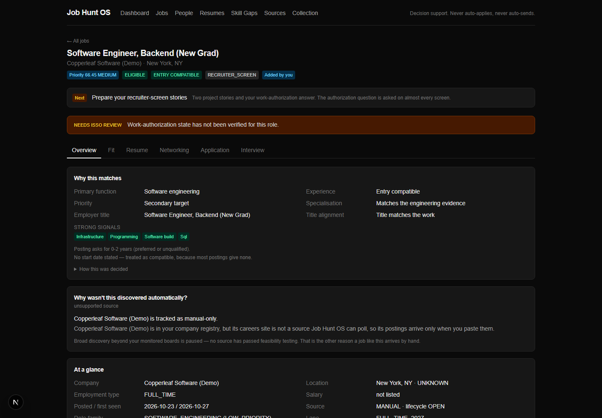
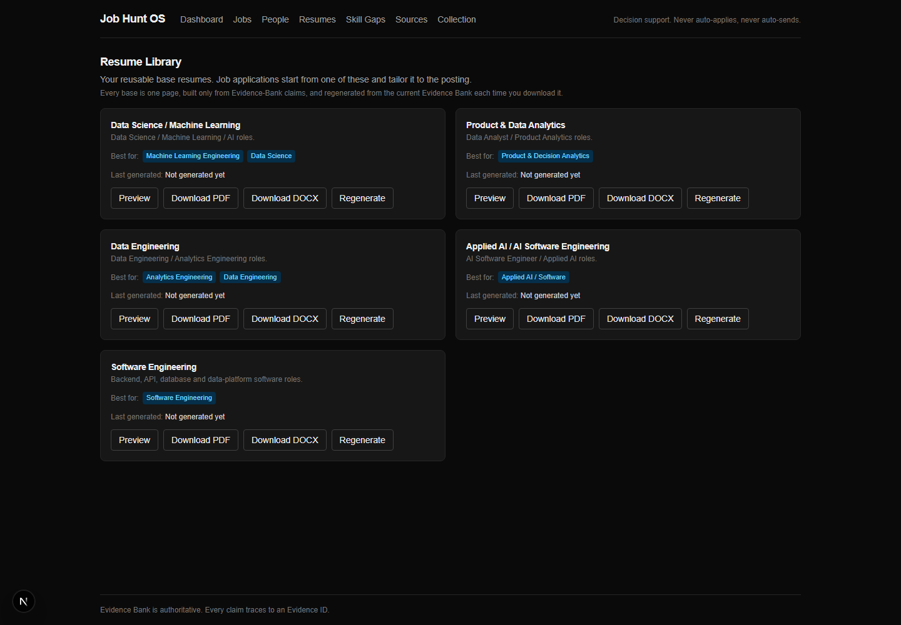
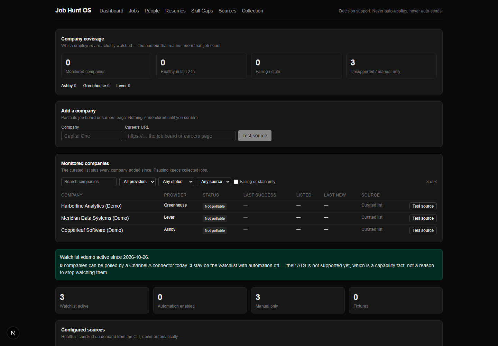
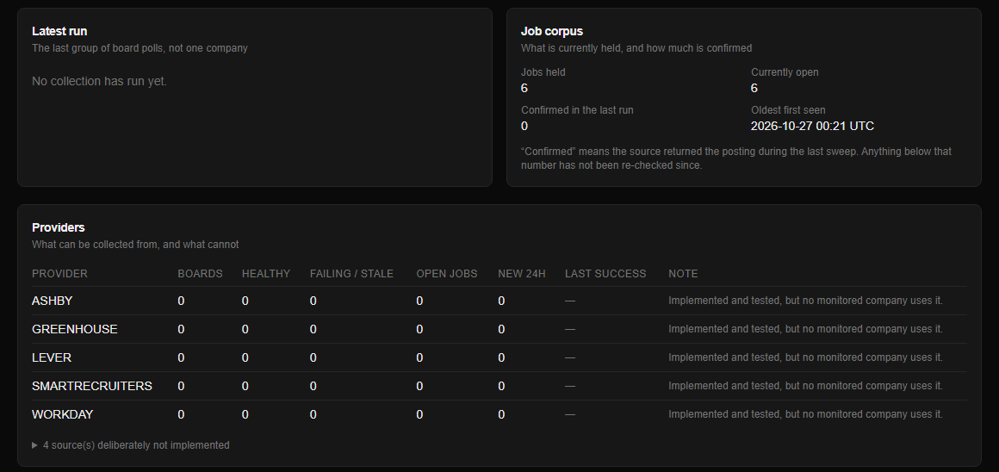

# Job Hunt OS

**Local-first job discovery, ATS ingestion, evidence-grounded resume tailoring and application workflow.**

Job Hunt OS is a personal system I built to run my own full-time job search. It
collects postings straight from employers' applicant-tracking systems, decides what
each posting is actually asking for, tailors a one-page resume using only claims
that trace to recorded evidence, and tracks applications, networking and follow-ups,
all on one machine with a SQLite database.

This repository is a **sanitized public copy**. It ships with a fictional demo
candidate (*Jordan Lee*) and synthetic data so the whole system runs end to end
without anyone's real career information. It is a portfolio project, not a hosted
product with users.

---

## The problem

A job search has three failure modes that generic tools don't address:

1. **Coverage.** The postings that fit a new graduate are spread across hundreds of
   employer career sites, and aggregators surface them late, duplicated or stale.
2. **Relevance.** Titles lie in both directions. "Analytics Engineer" can be data
   science; "Software Engineer, Data Platform" can be the best data-engineering fit
   in the feed. Filtering on titles throws away good roles.
3. **Truthful tailoring.** Tailoring a resume to a job description tempts you to copy
   the posting's keywords. A resume should change its *emphasis* for each job, never
   its *facts*.

## What it does

### ATS collection (data engineering)

- **Five public ATS connectors:** Greenhouse, Lever, Ashby, SmartRecruiters, and
  Workday career sites (their public JSON endpoint). No login, cookie or credential
  is ever used.
- **Company registry:** a curated, human-reviewed seed file plus companies added
  through the UI or CLI. Board detection checks that a board actually belongs to the
  named employer before it is monitored.
- **Normalization and deduplication** across sources, with source provenance kept per
  posting.
- **Freshness and disappearance tracking:** a posting missing from successful polls
  is first suspected closed, then closed after repeated misses. A failed poll proves
  nothing.
- **Polite HTTP:** bounded retries with exponential backoff and jitter, `Retry-After`
  honoured (and capped), no retry on ordinary 4xx, per-request timeouts, and a
  wall-clock deadline per board so one hung connection cannot stall a sweep.
- **Collection health:** per-board run history, failures and freshness on a Sources
  and Collection page. A cross-process lock means only one sweep runs at a time,
  whether it starts from the browser, the CLI or the OS scheduler.

### Application intelligence

- **Function-first classification:** the description decides what a role *is*; the
  title is one signal. Unusual titles over relevant work surface as **hidden fits**.
- **Fit and seniority analysis:** experience bars are read from the posting text, so
  an "early career" title that asks for 5+ years is flagged as a reach.
- **Why-missed diagnostics:** paste a URL the system did not find, and it explains
  why (registry state, ATS support, screening).

### Evidence-grounded resume pipeline

- **Evidence Bank:** a set of YAML files recording experiences, projects, evidence
  items, metrics (with status and mandatory caveats), safe claims and prohibited
  claims. The application loads and validates it, and never writes to it.
- **Supported claims only:** every bullet is the verbatim text of a safe claim and
  passes a claim validator. A keyword the posting asks for that the evidence does not
  support stays a **visible gap**; it is never added.
- **Role-family base resumes** (data science, analytics, data engineering, applied
  AI, software), each a complete one-page document before any tailoring.
- **Job-description tailoring:** claims are re-ranked by requirement match, role
  relevance, evidence strength and bullet quality. Projects compete for space by
  relevance; every paid experience keeps its place.
- **One-page PDF plus editable DOCX:** the PDF is rendered and its pages counted, and
  the lowest-value content is removed until it fits. The type is never shrunk to
  make it fit. Tests read the PDF back with a second, ATS-style text extractor.
  The DOCX is set in the same page geometry, faces, sizes and line heights, and
  measures one page in Microsoft Word on every resume checked; tests pin that
  layout and check its words match the PDF word for word.

### Local workflow

- Applications with a status history, next actions and stale-application detection.
- Contacts and networking: outreach **drafts** that pass the same evidence gate as a
  resume bullet, follow-up reminders, referral tracking. Nothing is ever sent by the
  system.
- Cover letters, built from the same evidence.
- A dashboard of what needs attention today.

**Human in the loop, always.** There is no auto-apply, no automated messaging, and
no account automation of any kind. The system drafts, tracks and reminds; a person
takes every irreversible step.

---

## Architecture



| Layer | Technology |
| --- | --- |
| Backend | Python 3.11, FastAPI, SQLAlchemy 2.0, Alembic, Pydantic v2 |
| Database | SQLite (WAL), migrations with Alembic |
| Frontend | Next.js (App Router), React, TypeScript, Tailwind CSS |
| API typing | FastAPI OpenAPI → `openapi-typescript` → typed client |
| Documents | ReportLab (PDF), python-docx (DOCX) |
| LLM | Optional (Anthropic SDK). With no API key everything runs deterministically. |
| Quality | pytest, ruff, mypy, ESLint, `tsc` |

## Technical challenges

**Keeping the UI writable during a long collection sweep.** SQLite allows one
writer. The first version held a write transaction open across each board's
network fetch, so any click that wrote to the database could wait behind a
multi-minute request. The fix moved every network call outside a transaction,
committed in small batches, and yielded briefly between batches so an interactive
write can take the lock. Probe measurements are below.

**Making an unchanged poll free.** A version check treated every prescreened-out
posting as stale, so most of the board was re-processed, and its raw payload
re-stored, on every poll. Comparing only the versions that apply to each record
brought an unchanged poll back to near-zero work.

**One page as a measured fact, not a budget.** Bullet and entry caps were each
calibrated once and then silently stopped holding when content changed. The
renderer now renders, counts pages, and removes the cheapest content in a fixed
order: project bullets first, then general skills, then whole projects. A paid
role is never removed.

**Truthful tailoring.** Ownership is tracked per claim (what the project did and
what the candidate personally did are separate fields). Recalled figures keep their
"~" and their scope, and causal verbs on correlational metrics are rejected. Each
of these is a validator rule with tests.

### Measured results

*Validated on a private local deployment (Windows, SQLite). These describe the
system, not anyone's job-search outcomes.*

| Measure | Result |
| --- | --- |
| ATS providers supported | 5 (Greenhouse, Lever, Ashby, SmartRecruiters, Workday) |
| Employer boards in one monitored sweep | 228 (Oct 2026) |
| Postings listed in that sweep | 35,343, in ~61 min |
| Interactive write availability during that sweep | 0 of 250 write-lock probes failed (worst wait 6.8 s) |
| Data written by a mostly-unchanged sweep | ~100 MB → 6.3 MB per sweep (57-board sweep, before vs after the fix) |

Write-lock probes were a separate connection running `BEGIN IMMEDIATE; ROLLBACK`
every two seconds for the length of the sweep.

---

## Run the demo

Requirements: Python 3.11+, Node.js 20.9+.

```bash
git clone https://github.com/TheFlashhhh/job-hunt-os.git
cd job-hunt-os
python -m venv .venv
```

Activate it (`source .venv/bin/activate` on macOS/Linux, `.venv\Scripts\activate`
on Windows), then:

```bash
pip install -e ".[dev]"
python -m app.cli demo bootstrap
```

`demo bootstrap` migrates a new `jobhunt.db` and fills it with fictional postings
(run through the real pipeline), a few applications and one contact. It refuses to
run unless the loaded Evidence Bank is the synthetic demo bank and the database
holds no jobs.

Start the backend:

```bash
python -m uvicorn app.main:app --port 8000
```

In a second terminal, start the frontend:

```bash
cd web
npm ci
npm run dev
```

Open http://localhost:3000. The **Resumes** page generates every base resume for
Jordan Lee as PDF and DOCX.

The demo registry contains only fictional companies with collection disabled, so
nothing is fetched until you add a real public board:

```bash
python -m app.cli company add "Example Co" https://boards.greenhouse.io/<board>
python -m app.cli collect
```

### Use it for real

Replace `data/*.yaml` with your own Evidence Bank (the demo files document the
schema), run `python scripts/validate_evidence_bank.py`, and point
`JOBHUNT_DB_URL` at a fresh database. Set `JOBHUNT_HTTP_CONTACT` in `.env` so job
boards can reach you about your traffic.

## Screenshots

All screenshots are of the synthetic demo.

| Dashboard | Jobs |
| --- | --- |
|  |  |
| **Job detail** | **Resume library** |
|  |  |
| **Sources** | **Collection** |
|  |  |

## Tests

```bash
python -m pytest -q
python -m ruff check .
python -m mypy app scripts
python scripts/validate_evidence_bank.py
cd web && npm run typecheck && npm run lint && npm run build
```

The public suite runs against the synthetic Evidence Bank and makes no network
calls. Tests that assert facts of my own Evidence Bank stay in the private
repository. CI runs all of the above on every push.

## Privacy

This copy is produced from my private working repository by an **allowlist**
exporter: only named files are copied, a synthetic Evidence Bank and demo registry
are laid on top, and a privacy gate scans the result for personal identifiers,
tracked companies, contacts, secrets and local paths before anything is written. It
has its own git history; the private repository's history is never published.

## License

No open-source license is granted. The code is published for reading and
evaluation; all rights are reserved.
